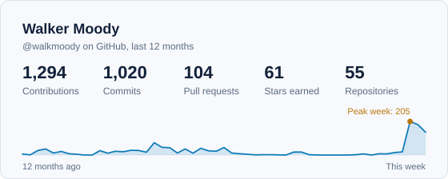
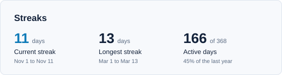
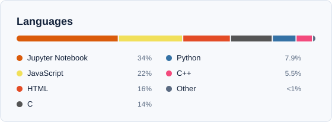

# GithubStats

Generates SVG stat cards for a GitHub profile README: yearly activity, contribution streaks and top languages, each in a dark and light theme.

A GitHub Action rebuilds the cards every day and commits them to `output/`, so there's no server to host or keep alive. Zero dependencies; it only needs Node 20+.

| Card | What it shows |
| --- | --- |
| `stats` | Contributions, commits, PRs, stars and repos for the last 12 months, plus a weekly activity line with the peak week marked |
| `streak` | Current streak, longest streak, and active days in the last year |
| `languages` | Top languages by bytes across your own (non-fork) repos |

## Try it locally

```bash
npm test          # unit tests
npm run demo      # sample data, writes to preview/
```

Open `preview/preview.html` in a browser to see every card on GitHub's dark and light backgrounds.

To use real data, copy `.env.example` to `.env`, add a token, then run:

```bash
npm run generate  # writes to output/
```

## Set it up on GitHub

1. Push this folder to a public repo named `GithubStats`.
2. (Optional) To count private contributions, create a [classic personal access token](https://github.com/settings/tokens) with the `read:user` and `repo` scopes, and add it as a repo secret named `STATS_TOKEN`. Then add a repo variable `INCLUDE_PRIVATE` set to `true` if you also want private repos in the language card. Without the secret, the workflow uses the built-in token and shows public data only.
3. Go to **Actions → Update stat cards → Run workflow**. After it finishes, `output/` holds the cards.

## Add the cards to your profile README

`<picture>` makes each card match the viewer's GitHub theme:

```html
<picture>
  <source media="(prefers-color-scheme: dark)" srcset="https://raw.githubusercontent.com/walkmoody/GithubStats/main/output/stats-dark.svg">
  
</picture>

<picture>
  <source media="(prefers-color-scheme: dark)" srcset="https://raw.githubusercontent.com/walkmoody/GithubStats/main/output/streak-dark.svg">
  
</picture>

<picture>
  <source media="(prefers-color-scheme: dark)" srcset="https://raw.githubusercontent.com/walkmoody/GithubStats/main/output/languages-dark.svg">
  
</picture>
```

## Settings

Set these in `.env` locally, or as repo variables (Settings → Secrets and variables → Actions → Variables) for the workflow.

| Variable | Default | Purpose |
| --- | --- | --- |
| `GH_USERNAME` | repo owner | Whose stats to show |
| `INCLUDE_PRIVATE` | `false` | Include private repos in stars, repo count and languages |
| `EXCLUDE_LANGS` | `HTML,CSS,Jupyter Notebook` | Languages to leave out; set it to an empty value to keep everything |
| `EXCLUDE_REPOS` | none | Repos to leave out, comma-separated |
| `TOP_LANGUAGES` | `6` | How many languages before the rest become "Other" |

## Project layout

```
src/
  index.js         CLI entry: loads config, fetches data, writes cards
  github.js        GitHub GraphQL queries
  stats.js         Streaks, language totals, card model
  svg.js           Themes and shared SVG helpers
  demo.js          Sample data for npm run demo
  cards/           One file per card
test/              node:test unit tests
.github/workflows/ Daily regeneration
```

## Adding a card

Write a function in `src/cards/` that takes `(model, theme)` and returns an SVG string built with `frame()`, then register it in the `CARDS` map in `src/index.js`.
